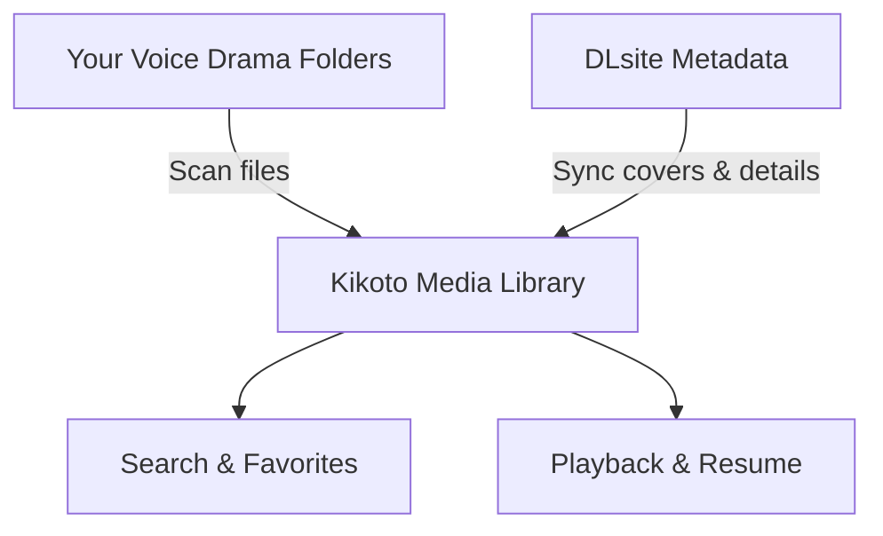
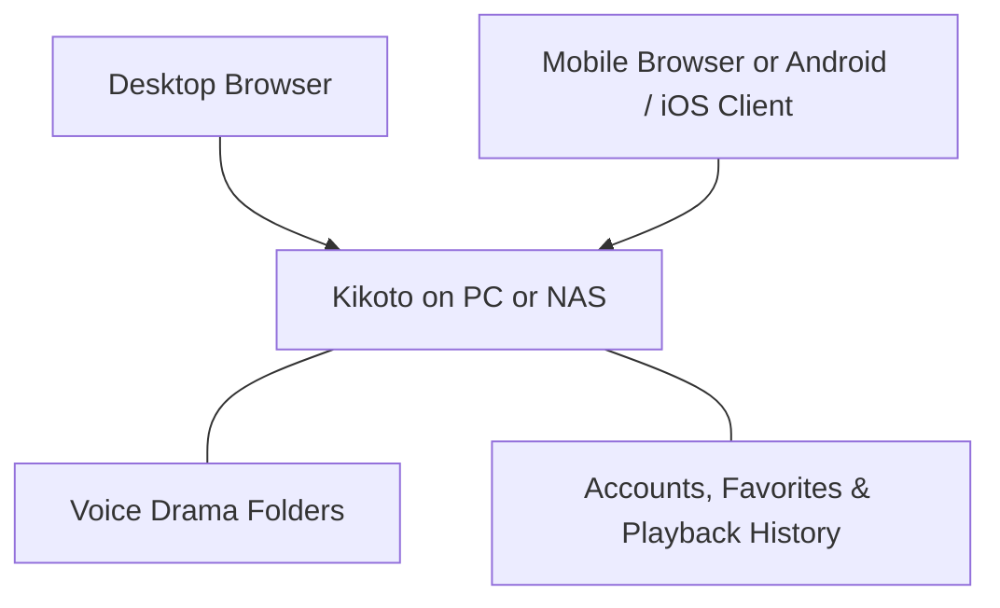

 This article was translated by gemini-3.6-flash 

This article was written by GPT-6.1 Sol and updated by Claude Opus 5.5.

As your collection of voice dramas grows, your folders get longer and longer. Sometimes you can only remember the cover image or the voice actor, but not the title; other times, you stopped listening halfway through last night and have to drag the progress bar around the next day just to find your spot. Even though the files are on your own hard drive, finding them and picking up where you left off can still take extra effort.

Kikoto is an open-source voice drama library I created to bring all these tasks together: browse works by cover image, find tracks by voice actor or tag, curate lists of what you want to listen to, and resume right from where you stopped. Deployed on a PC or NAS, both web browsers and Android/iOS clients can access the same library. The following introduction is based on Kikoto v0.10.0.




If you'd like to check out the interface first, feel free to open the [online demo](https://kikoto.yexca.net/). The demo site is read-only and displays free all-ages works from DLsite. Kikoto itself does not provide audio resources; it is designed to manage the content you own.

## Turn Folders into a Searchable Media Library

Kikoto scans your specified audio directories, identifies works by recognizing product IDs like `RJ` numbers in folder names, and synchronizes titles, cover images, circles, voice actors, and tags from DLsite. You can continue using your original directory structure without needing to manually input every file first.

You can think of the ingestion process as two parallel tracks: one locates files on your hard drive, while the other fetches work metadata, allowing you to browse and play everything within a single media library.



If you want to listen to works by a specific voice actor, you can search for their name directly; if you only remember the circle name, part of the title, or the product ID, you can find it just as easily. For more precise filtering, use `tag: 癒し`, `circle:`, or `va:` to restrict tags, circles, or voice actors, respectively, or prefix a `-` to exclude matching works. When tags have multilingual names configured, searching in other languages works as well.

During daily use, you can browse works by recommendations, recently added, ratings, sales, or release dates. When you can't decide, you can also let it pick randomly. Clicking into a circle or voice actor page lets you follow your favorite creators to discover more of their works.


The details page puts the cover image, production metadata, and file directory together. Audio tracks can be played directly, while images, text files, and subtitles in the same folder can be previewed without switching back to a file manager.

Multilingual works offer two independent options: **Metadata Language** changes the display language of titles, descriptions, and tags when available, while **Directory Version** switches the actual files. For example, you can browse Japanese audio tracks with Chinese titles, or switch to a saved English folder version. Changing the display language for text does not alter the audio itself.

## Pick Up Right Where You Left Off

Click an audio track to start playing, and other tracks in the same folder will be queued automatically. As you browse other works, playback continues uninterrupted; the player can be collapsed and expanded whenever you need to check lyrics or manage the queue.

Kikoto saves your listening progress. The next time you open a work, clicking "Resume" returns you to where you left off, so you don't have to guess which track you were on. If you want to listen to a specific track from the beginning, just click that track directly.


When a work includes subtitle files such as LRC, VTT, or SRT, they can be displayed like lyrics synchronized with the audio. Sentences with timestamps can be clicked to jump directly to that position—if you missed a line, just click back. If multiple matching lyric files exist, you can select your preferred one manually.

For tracks without lyrics, you can use speech recognition under "Manage Lyrics" on the work page to transcribe the audio into timed lyrics, previewing and confirming them before saving. Existing lyrics, as well as titles, descriptions, tags, and file names, can also be translated into other languages using "AI Translation." Lyrics are saved separately by language, and playback prioritizes your configured metadata language; AI-generated lyrics are also clearly labeled in the player.

Transcription and translation require an administrator to first configure a service under "Settings → Speech Recognition & LLM." You can use OpenAI-compatible APIs, Ollama, or run models locally on Windows using [Kikoto Helper](https://github.com/yexca/kikoto-helper). When using external services, remember to review their terms of service first.

The player also supports speed adjustment, queue reordering, 10-second rewind, and 30-second fast-forward. If you listen before sleep, you can set a sleep timer and configure it to rewind slightly after stopping, making it easier to find where you were the next day.

Desktop browsers can pop out lyrics into a Picture-in-Picture window; the Android client can display floating lyrics over other apps when granted the permission; and the iOS client uses Picture-in-Picture mode. You don't have to stay on the player page just to follow along with the lyrics.

## Organize What You Want to Listen to and What You've Finished

While folders usually only tell you "what files exist," collection shelves can show you "what you plan to listen to, what you are listening to, and what you have finished." Both work cards and detail pages feature quick status tags to mark works as *Want to Listen*, *Listening*, *Completed*, *Re-listening*, or *On Hold*; next to them, you can also leave a personal rating from 1 to 5 stars. Works can also be added to custom playlists—such as sleep audio, favorite ear cleaning tracks, or story tracks you want to re-listen to—while dynamic lists automatically collect works based on tags.

Personal tags can be attached to works, circles, and voice actors. Ratings, collections, and status marks feed into the recommendation engine: works rated 4 or 5 stars boost similar works higher, while 1 or 2 stars push them lower. Personal collections and playback data are stored separately per account, allowing different users to organize the same library in their own way.

## Not Sure What to Listen to? Check Out "Discover"

The "Discover" page helps you find your next listen. "Recommended for You" picks a few local works each time: things you might like, works you rarely listen to, or past favorites you haven't played in a while, with each card listing the reason it was picked. Clicking the bell icon on a circle, series, or voice actor page subscribes to them, showing their new releases under "New Releases"; "Rankings" tracks rank movements on DLsite.

To look back at what you've listened to, open the "Analytics Dashboard." It provides a one-year listening calendar, an annual report, and a taste profile generated by comparing your habits against the entire media library, highlighting your most played works, voice actors, circles, and tags.

## Manage Files Even When Scattered Across Different Locations

When your collection is spread across multiple hard drives, you can use Storage Pools, adding each drive as an independent media location. If a drive is temporarily disconnected, it will show as offline, but existing work records on that drive will remain intact during scans.

If duplicate copies of the same work reside in different folders, open the work's "Manage Files" page to consolidate necessary files from other folders or remote locations into a single folder. "Find Duplicates" flags identical copies based on content, letting you inspect them before deleting.

If you already have access to a Kikoeru-compatible service, you can also add it as a remote source to browse, play, or fetch files on demand. Local, cached, and remote locations of the same work are managed around a single unified work record, so your favorites and listening history don't need to be recreated whenever file paths change.

Remote playback, caching, and fetching each serve distinct purposes: playback streams directly, caching keeps a rebuildable media copy, and fetching saves selected files to your own media directory. If you only want to organize local files, starting with a single audio folder is more than enough.

Tasks such as scanning, metadata syncing, file fetching, transcription, and translation run as background workflows, with progress and results visible under "Activity." If you need periodic scanning or metadata synchronization, set up automated rules under "Workflows." To track new releases from circles or voice actors, use the subscription feature mentioned earlier.

## Set Up Your Own Voice Drama Server with Docker

Deploying via Docker Compose is recommended. You'll need a computer or NAS capable of running Docker, as well as your stored audio files. Images support both `linux/amd64` and `linux/arm64`, meaning ARM-based NAS devices and 64-bit Raspberry Pi OS are supported. Once deployed, all files and account data stay on your own device, accessed via a browser or mobile client.



For Windows users, there is also [Kikoto Helper](https://github.com/yexca/kikoto-helper), which can help deploy and manage Kikoto. It is now developed and published in an independent repository. However, it is **not the recommended deployment method** and is only intended for situations where Docker cannot be run properly. If Docker is available, simply follow the steps below. The Helper's other main use is running local speech recognition and translation models, which Docker-deployed Kikoto instances can also connect to. The legacy `kikoto-helper.cmd` script in the main Kikoto repository is no longer maintained.

### Preparing Docker and the Deployment Directory

On Windows, install [Docker Desktop](https://docs.docker.com/desktop/setup/install/windows-install/); on macOS, use [OrbStack](https://orbstack.dev/download) or Docker Desktop; on Linux, install [Docker Engine](https://docs.docker.com/engine/install/) and the Compose plugin according to your distribution. For a NAS, use its built-in container management tool.

After installation, verify that your terminal can run:

```sh
docker compose version
```

Next, create a dedicated deployment directory, such as `D:\kikoto` on Windows. Download the provided [docker-compose.yml](https://github.com/yexca/kikoto/blob/main/docker-compose.yml) into this directory, and set up the following directory structure:

```text
kikoto/
├── config/
├── cache/
├── data/
└── docker-compose.yml
```

`config` stores user accounts, the database, and listening history; `cache` stores cached files; and `data` is used by default for storing audio files. On macOS or Linux, you can also download the configuration in the deployment folder using:

```sh
curl -fL https://raw.githubusercontent.com/yexca/kikoto/main/docker-compose.yml -o docker-compose.yml
```

### Telling Kikoto Where Your Audio Files Are

Open `docker-compose.yml` and locate `volumes`. The default configuration looks like this (this is a snippet from the full file):

```yaml
volumes:
  - ./config:/config
  - ./cache:/cache
  - ./data:/data
```

The path to the left of the colon on each line represents the folder on your host machine, while the right side is the path as seen inside the container. **If your audio files already exist in another directory, simply modify the left path—you do not need to copy the files over.**

For example, if your audio files on Windows are in `D:\Audio`, change it to:

```yaml
volumes:
  - ./config:/config
  - ./cache:/cache
  - "D:/Audio:/data"
```

On macOS or Linux, replace the left side similarly, e.g., `/mnt/audio:/data`. On Windows, use forward slashes `/` inside quotes, maintaining the original indentation when saving.

If you plan to use Storage Pools, keep `./data:/data`, and map individual drives as subdirectories like `/data/disk1`, `/data/disk2`, etc. Then select the corresponding pools during initial setup. For details, refer to the [Getting Started Guide](https://github.com/yexca/kikoto/blob/main/docs/user/en/getting-started.md).

### Starting Up and Initial Setup

Open a terminal in your deployment directory, validate the configuration, and start the service:

```sh
docker compose config --quiet
docker compose up -d
```

Once the image is downloaded and running, open `http://127.0.0.1:7655` on that computer. The initial visit will prompt you to create an admin account. The setup token can be found in the container logs:

```sh
docker compose logs kikoto
```

Alternatively, you can read the `config/setup-token` file directly. Enter the token, set your username and password, and follow the "Setup Media Library" wizard:

1. Choose Normal mode or Storage Pool mode.
2. Scan the audio directory to discover local works.
3. Synchronize metadata to populate covers and descriptions.
4. Enable auto-scan and directory watching as needed.

Folder names must contain a supported product ID format (e.g., RJ numbers). If nothing shows up after scanning, check your volume mappings and directory naming; if covers don't appear immediately, check the metadata sync progress under "Activity."

### Accessing from Mobile

To access Kikoto from a mobile device on the same local network, enter your host machine's LAN IP address, such as `http://192.168.1.23:7655`. Replace this IP address with your actual local IP (`127.0.0.1` on a phone refers to the phone itself).

On Windows, use `ipconfig` to find your Wi-Fi or Ethernet adapter's IPv4 address. If connection fails, check your computer's firewall settings and router guest network isolation. The server machine must remain running.

Android and iOS clients are available on [GitHub Releases](https://github.com/yexca/kikoto/releases): download and install the APK for Android; the iOS release is an unsigned IPA that needs to be sideloaded and signed with your own Apple account. Open the client app and enter the same server URL.

The default port mapping listens on all network interfaces of the host device. **Do not expose Kikoto directly to the public internet.** If you only plan to use it locally on the host machine, you can change `ports` to `127.0.0.1:7655:7659`. If you need remote access while away, set up proper security measures first—such as connecting back via an encrypted private mesh network (Tailscale, WireGuard, etc.) or placing a reverse proxy with HTTPS and authentication in front of it. Refer to the [Security Documentation](https://github.com/yexca/kikoto/blob/main/docs/operations/security.md) for details.

## Backup and Routine Maintenance

The most important data to back up are your original audio files, as well as the database and personal data inside `config`. Caches can generally be rebuilt. Kikoto also supports exporting and importing personal marks, ratings, tags, custom playlists, and listening history (and importing from Kikoeru), allowing you to migrate seamlessly when switching devices or instances.

Before upgrading, check the [Release Notes](https://github.com/yexca/kikoto/blob/main/docs/history/index.md) for any noteworthy changes. Back up your `config` directory as well as deployment files like `docker-compose.yml` and `.env`. Keep your audio folder mappings unchanged (no copying required). Then execute the following in your deployment directory:

```sh
docker compose up -d --pull always
```

This command pulls the latest image and recreates the container; the database will upgrade automatically upon startup. If you pinned a specific version tag using `KIKOTO_IMAGE` in `.env`, update it to the new version before running the command.

For further instructions, please consult the [Documentation](https://github.com/yexca/kikoto/blob/main/docs/user/index.md).

If you encounter issues or have ideas, feel free to open an Issue in the GitHub repository.