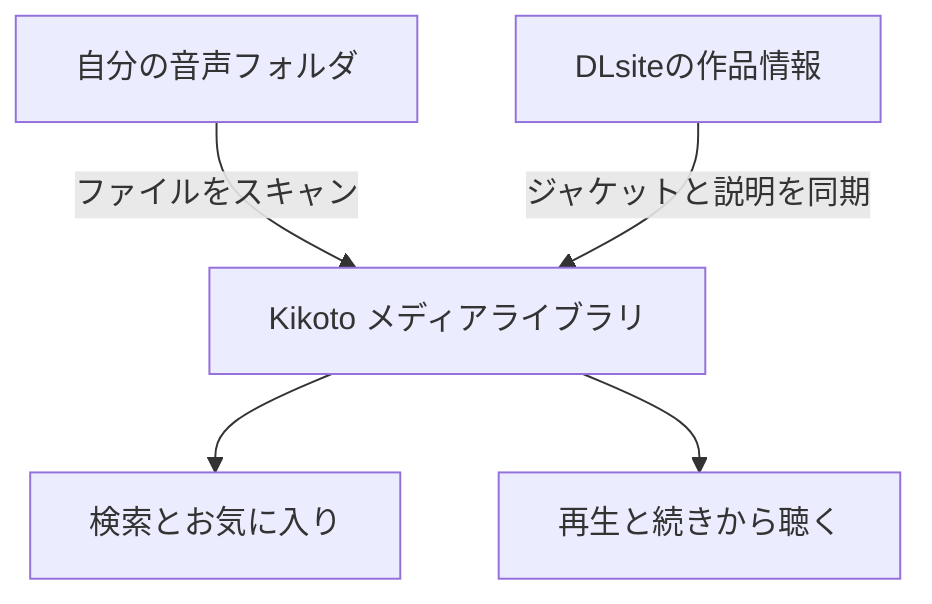
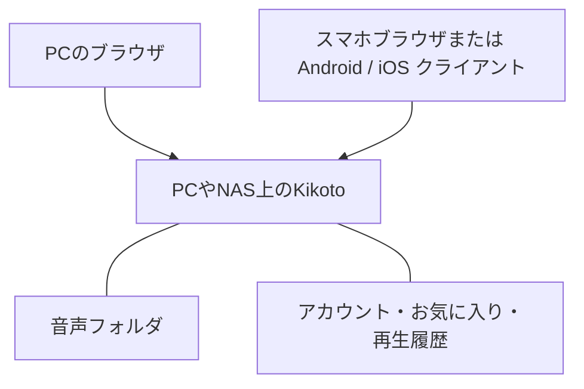

 この記事は gemini-3.6-flash によって翻訳されました 

この記事は GPT-6.1 Sol によって作成され、Claude Opus 5.5 によって更新されました。

同人音声をたくさん買っていると、フォルダがどんどん増えていきます。ジャケット写真や声優（CV）は覚えているのに作品名を思い出せなかったり、昨晩途中まで聴いた作品の続きを翌日シークバーで探したりすることもあります。ファイルはすべて自分のハードディスク内にあるのに、見つけて続きを聞くだけでも一苦労です。

Kikotoは、私が開発したオープンソースの音声ライブラリシステムです。ジャケット画像でのブラウジング、声優やタグによる検索、聴きたいリストの作成、前回停止した場所からの続き再生など、これらの機能を一つにまとめました。PCやNASにデプロイすることで、ブラウザやAndroid、iOSクライアントから同じライブラリにアクセスできます。以下では、Kikoto v0.10.0 をベースに紹介します。




画面イメージを先に確認したい場合は、[オンラインデモ](https://kikoto.yexca.net/)をご覧ください。デモサイトは読み取り専用で、DLsiteの無料全年龄作品を表示しています。Kikoto自体は音声コンテンツを提供せず、ご自身が購入した作品を管理するためのツールです。

## フォルダを検索可能なメディアライブラリに変える

Kikotoは指定した音声ディレクトリをスキャンし、フォルダ名に含まれる `RJ` などの作品番号（品番）から作品を認識し、DLsiteからタイトル、ジャケット画像、サークル、声優（CV）、タグを同期します。既存のディレクトリ構造をそのまま利用できるため、手動でファイルを1つずつ登録し直す必要はありません。

ライブラリ化の流れは大きく2つのルートに分けられます。1つはHDD上のファイルを見つけること、もう1つは作品情報を補完することです。最終的に同じメディアライブラリ上で閲覧・再生できるようになります。



特定の声優の作品を聴きたい時は名前で検索でき、サークル名やタイトルの一部、作品番号しか覚えていない場合でも見つけることができます。さらに絞り込みたい場合は、`tag: 癒し`、`circle:`、`va:` でそれぞれタグ、サークル、声優を指定でき、先頭に `-` を付けることで除外検索も可能です。タグに多言語名が設定されている場合は、他言語の名前でもマッチします。

通常はおすすめ、最近追加された項目、評価、販売数、発売日順でブラウジングできます。選ぶのが面倒な時はランダム表示も可能です。サークルや声優のページに入れば、お気に入りのクリエイターから作品を探せます。


詳細ページにはジャケット画像、制作情報、ファイルディレクトリがまとめて表示されます。音声トラックは直接再生でき、同フォルダ内の画像、テキスト、字幕のプレビューも可能なため、付属コンテンツを見るためにファイルマネージャーに切り替える必要はありません。

多言語対応作品には2つの独立した設定があります。**メタデータ言語**は対応コンテンツがある場合にタイトル・説明・タグの表示言語を変更し、**ディレクトリバージョン**は実際のファイルを切り替えます。例えば、中国語のタイトルで日本語トラックを閲覧したり、保存済みの英語版ディレクトリを開いたりできます。表示テキストの言語を切り替えても、音声データ自体は変わりません。

## どこまで聴いたか記録し、次回は続きから

トラックをタップして再生を開始すると、同じフォルダ内の他のトラックが再生キューに入ります。他の作品をブラウジングしている間も再生は継続され、プレイヤーを折りたたむこともできます。歌詞の確認やキューの調整が必要な時に展開可能です。

Kikotoは再生進捗を自動保存します。次回作品を開いた時に「続きから再生」をタップするだけで前回の再生位置に戻れるため、どのトラックだったか探す必要はありません。最初から聴きたい場合は、該当のトラックを直接選択します。


LRC、VTT、SRT などの字幕ファイルが作品に付属している場合は、歌詞のように音声に合わせて表示できます。タイムスタンプ付きのフレーズをタップしてその位置にジャンプできるため、聞き逃した箇所へ簡単に戻ることができます。複数の歌詞ファイルが存在する場合は、手動で選択可能です。

歌詞がないトラックでも、作品の「歌詞管理」から音声認識機能を使ってタイムスタンプ付き歌詞を書き起こし（文字起こし）、プレビュー確認後に追加できます。既存の歌詞やタイトル、説明文、タグ、ファイル名も「AI翻訳」を使って他言語を追加できます。歌詞は言語ごとに保存され、再生時には設定したメタデータ言語が優先されます。AIで生成された歌詞にはプレイヤー上にマークが表示されます。

文字起こしや翻訳機能を使用するには、管理者が事前に「設定 → 音声認識と大規模言語モデル」でサービスを連携する必要があります。OpenAI互換APIやOllamaなどが利用できるほか、[Kikoto Helper](https://github.com/yexca/kikoto-helper) を使用してWindows PC上でローカルモデルを実行することも可能です。外部サービスを利用する際は、利用規約をご確認ください。

プレイヤーは倍速再生、キューの並び替え、10秒巻き戻し / 30秒早送りに対応しています。就寝時に聴く場合はスリープタイマーを設定でき、停止後に少し巻き戻すように設定しておくことで、翌日覚えていた位置を見つけやすくなります。

PCブラウザでは歌詞をピクチャー・イン・ピクチャー（PiP）小窓に表示できます。Androidクライアントはオーバーレイ権限（フローティングウィンドウ）を取得することで他アプリの上に歌詞を表示でき、iOSクライアントはPiPウィンドウで表示します。歌詞を見るために常にプレイヤー画面にとどまる必要はありません。

## 聴きたい作品と聴き終わった作品を整理する

フォルダ管理では「どの作品があるか」しか分かりませんが、コレクション機能を使えば「次に聴く予定」「再生中」「聴取済み」「再聴取中」「保留」を整理できます。作品カードや詳細ページにはクイックマークがあり、制作者の設定したステータスを設定できるほか、1〜5つ星で個人的な評価を付けられます。また、「就寝用」「お気に入りの耳かき」「もう一度聴きたいストーリー」など自分で作成したプレイリストに登録することも可能です。スマートリスト（動的リスト）では、タグに基づいて自動的に作品が収集されます。

個人用タグは作品、サークル、声優に付与できます。評価、お気に入り、ステータスはレコメンド（おすすめ）に反映され、4〜5つ星を付けた作品と類似する作品は上位に表示され、1〜2つ星の作品は優先度が下がります。アカウントごとに個人のお気に入りや再生履歴が独立して保存されるため、1つのライブラリを複数のユーザーで異なる整理方法で使用できます。

## 何を聴くか迷ったら「発見」へ

「発見」ページは次に聴く作品を探すための機能です。「おすすめ」では、ローカル作品の中から「好きそうな作品」「普段あまり聴かない作品」「以前好きだったがしばらく聴いていない作品」などを抽出し、カードごとに推薦理由が表示されます。サークル、シリーズ、声優のページでベルマークをタップして購読すると、彼らの新作が「新作」欄に表示されます。「ランキング」ではDLsiteのランキング順位の変化を追跡できます。

自分の聴取傾向を振り返りたい時は「ダッシュボード」を開きます。1年間の再生カレンダー、年間レポート、ライブラリ全体との比較による好みのアナリティクスが表示され、最もよく聴いた作品、声優、サークル、タグを確認できます。

## ファイルが異なる場所にあっても一元管理

作品が複数のハードディスクに分散している場合はストレージプールを使用し、各ドライブを独立したメディアロケーションとして追加できます。特定のドライブが接続されていない場合は「オフライン」と表示され、スキャン時もそのドライブ上の既存作品レコードは保持されます。

同じ作品が複数のフォルダに重複して存在する場合は、作品の「ファイル管理」を開き、他のフォルダやリモートバージョンから必要なファイルを1つのフォルダに集約できます。「重複ファイルの検索」機能はコンテンツに基づいて完全に同一のコピーを検出し、確認後に削除できます。

すでにアクセス権のある Kikoeru 互換サービスがある場合は、それをリモートソースとして追加し、ファイルの閲覧、再生、オンデマンド取得が可能です。同一作品のローカル、キャッシュ、リモート位置は単一の作品レコードとして管理されるため、ファイル位置ごとにコレクションや再生履歴を重複作成する必要はありません。

リモート再生、キャッシュ、Fetch（取得）にはそれぞれの役割があります。再生は直接試聴、キャッシュは再構築可能なメディアコピーの保持、Fetchは選択したファイルを自身のメディアディレクトリに保存します。ローカル作品の整理だけであれば、1つの音声フォルダから始めるだけで十分です。

スキャン、作品情報の同期、ファイル取得、文字起こしや翻訳などのタスクはワークフローとして実行され、進捗と結果は「アクティビティ」で確認できます。定期的なスキャンや作品情報の同期が必要な場合は「ワークフロー」で自動実行ルールを設定し、サークルや声優の新作チェックには前述の「購読」機能を使用します。

## Dockerを使って自分専用の音声ライブラリを構築する

Docker Compose を使ったデプロイを推奨します。Docker が動作する PC または NAS と、保存済みの音声ファイルをご用意ください。イメージは `linux/amd64` および `linux/arm64` に対応しており、ARM アーキテクチャの NAS や 64 ビット版 Raspberry Pi OS でも動作します。デプロイ完了後、ファイルとアカウントデータはご自身のデバイス上に保存され、ブラウザやクライアントからアクセスします。



Windows 向けには [Kikoto Helper](https://github.com/yexca/kikoto-helper) も用意されており、Kikoto のデプロイや管理を補助できます（現在は独立したリポジトリで開発・公開されています）。ただし、これは**推奨されるデプロイ方法ではありません**。Docker がどうしても正常に動作しない場合にのみ適しています。Docker を利用できる環境であれば、以下の手順通りにデプロイしてください。Helper のもう1つの用途は、ローカルで音声認識や翻訳モデルを実行することであり、Docker でデプロイした Kikoto からも連携可能です。なお、旧 Kikoto リポジトリ内の `kikoto-helper.cmd` スクリプトはすでにメンテナンスされていません。

### Dockerとデプロイ用ディレクトリの準備

Windows は [Docker Desktop](https://docs.docker.com/desktop/setup/install/windows-install/)、macOS は [OrbStack](https://orbstack.dev/download) または Docker Desktop、Linux は各ディストリビューション手順に従い [Docker Engine](https://docs.docker.com/engine/install/) と Compose プラグインをインストールします。NAS の場合はシステム付属のコンテナ管理ツールを使用してください。

インストール後、ターミナルで以下が実行できることを確認します。

```sh
docker compose version
```

次に、デプロイ専用のフォルダ（例: Windows の場合は `D:\kikoto`）を作成します。プロジェクトが提供する [docker-compose.yml](https://github.com/yexca/kikoto/blob/main/docker-compose.yml) をダウンロードしてこのフォルダに配置し、以下のディレクトリを準備します。

```text
kikoto/
├── config/
├── cache/
├── data/
└── docker-compose.yml
```

`config` にはアカウント、データベース、再生履歴が保存され、`cache` にはキャッシュ、`data` はデフォルトで音声ファイルを配置する場所として使用されます。macOS や Linux では、デプロイディレクトリで以下のコマンドを実行して設定をダウンロードすることもできます。

```sh
curl -fL https://raw.githubusercontent.com/yexca/kikoto/main/docker-compose.yml -o docker-compose.yml
```

### 音声ファイルの保存場所を Kikoto に設定する

`docker-compose.yml` を開き、`volumes` の項目を探します。デフォルト設定は以下の通りです（ファイル全体の一部分です）。

```yaml
volumes:
  - ./config:/config
  - ./cache:/cache
  - ./data:/data
```

各行のコロン（`:`）の左側は PC 上のフォルダ、右側はコンテナ内で認識されるパスです。**音声ファイルがすでに別のディレクトリにある場合は、左側のパスを変更するだけでよく、ファイルをコピーし直す必要はありません。**

例えば、Windows で音声が `D:\Audio` にある場合は以下のように変更します。

```yaml
volumes:
  - ./config:/config
  - ./cache:/cache
  - "D:/Audio:/data"
```

macOS や Linux の場合も同様に左側のディレクトリを置き換えます（例: `/mnt/audio:/data`）。Windows のパスはスラッシュ `/` を使用しダブルクォーテーションで囲んでください。保存時は元のファイルのインデントを維持してください。

ストレージプールを使用する場合は `./data:/data` を維持し、各ドライブを `/data/disk1`、`/data/disk2` などのサブディレクトリとしてマッピングした上で、初回設定時に対応するプールを選択します。詳細な設定は[ユーザーガイド](https://github.com/yexca/kikoto/blob/main/docs/user/zh-Hans/getting-started.md#存储池)を参照してください。

### 起動と初回セットアップ

デプロイディレクトリでターミナルを開き、まず設定を確認してから起動します。

```sh
docker compose config --quiet
docker compose up -d
```

イメージのダウンロードと起動が完了したら、この PC で `http://127.0.0.1:7655` を開きます。初回アクセス時には管理者アカウントの作成が求められます。初期化トークン（Setup Token）はログから確認できます。

```sh
docker compose logs kikoto
```

または `config/setup-token` ファイルを読み取ることもできます。トークンを入力し、ユーザー名とパスワードを設定した上で、「メディアライブラリの設定」ウィザードに従って完了させます。

1. 通常モードかストレージプールモードを選択。
2. 音声ディレクトリをスキャンし、ローカル作品を検出。
3. 作品情報を同期し、ジャケットや説明文を補完。
4. 必要に応じて自動スキャンとフォルダ監視を有効化。

作品ディレクトリ名には対応する作品番号が含まれている必要があります。スキャンしても何も表示されない場合は、まずディレクトリマッピングとフォルダ名を確認してください。ジャケット画像がすぐに表示されない場合は、「アクティビティ」でメタデータ同期の進捗状況を確認できます。

### スマートフォンからのアクセス

スマホをデプロイ先デバイスと同じLAN（Wi-Fi）に接続し、PCのローカルIPアドレスでアクセスします（例: `http://192.168.1.23:7655`）。IPアドレスはご自身の環境に合わせて置き換えてください（スマホで `127.0.0.1` にアクセスするとスマホ自身を指してしまいます）。

Windows の場合は `ipconfig` コマンドで Wi-Fi やイーサネットアダプターの IPv4 アドレスを確認できます。接続できない場合は、PCのファイアウォール設定やルーターのゲストネットワーク分離設定を確認してください。なお、デプロイしたデバイスは稼働した状態にしておく必要があります。

Android および iOS クライアントは [GitHub Releases](https://github.com/yexca/kikoto/releases) から入手できます。Android は APK をダウンロードしてインストールします。iOS は署名なしの IPA ファイルとして提供されるため、サイドロードツールを使用しご自身の Apple アカウントで署名してインストールする必要があります。アプリを起動後、同じサーバーアドレスを入力すれば利用可能です。

デフォルトのポートマッピングはすべてのネットワークインターフェースをリッスンします。**Kikoto を直接インターネット（公有網）に公開しないでください**。ローカル環境のみで使用する場合は、`ports` を `127.0.0.1:7655:7659` に変更できます。外出先から聴く場合は、事前にアクセス保護を行ってください。例えば、暗号化されたプライベートネットワーク（VPNやTailscale等）経由でのみ自宅に接続できるようにするか、HTTPS と認証機能を備えたリバースプロキシを前段に配置します。詳細は[セキュリティ説明](https://github.com/yexca/kikoto/blob/main/docs/operations/security.md)を参照してください。

## バックアップと日常のメンテナンス

最も大切なのは音声の元ファイルと `config` 内のデータベースおよび個人データです。キャッシュは基本的に再構築可能です。Kikoto は個人のマーク、評価、タグ、プレイリスト、再生履歴のインポート・エクスポートにも対応しており、Kikoeru からのインポートも可能です。デバイスの買い替えやインスタンス移行時にもデータを引き継ぐことができます。

アップデート前にはまず[リリースノート](https://github.com/yexca/kikoto/blob/main/docs/history/index.md)を確認し、注意点や変更点を把握してください。次に `config` や `docker-compose.yml`、`.env` などの設定ファイルをバックアップします。音声ディレクトリのマッピングはそのままで問題ありません。その後、デプロイディレクトリで以下を実行します。

```sh
docker compose up -d --pull always
```

このコマンドは最新のイメージを取得してコンテナを再構築します。データベースは起動時に自動的にアップグレードされます。もし `.env` 内で `KIKOTO_IMAGE` を特定のバージョンに固定している場合は、新しいバージョンに変更してから実行してください。

詳細な操作方法は[ドキュメントを参照](https://github.com/yexca/kikoto/blob/main/docs/user/index.md)してください。

何か問題が発生した場合やアイディアがある場合は、リポジトリで Issue を作成してください。